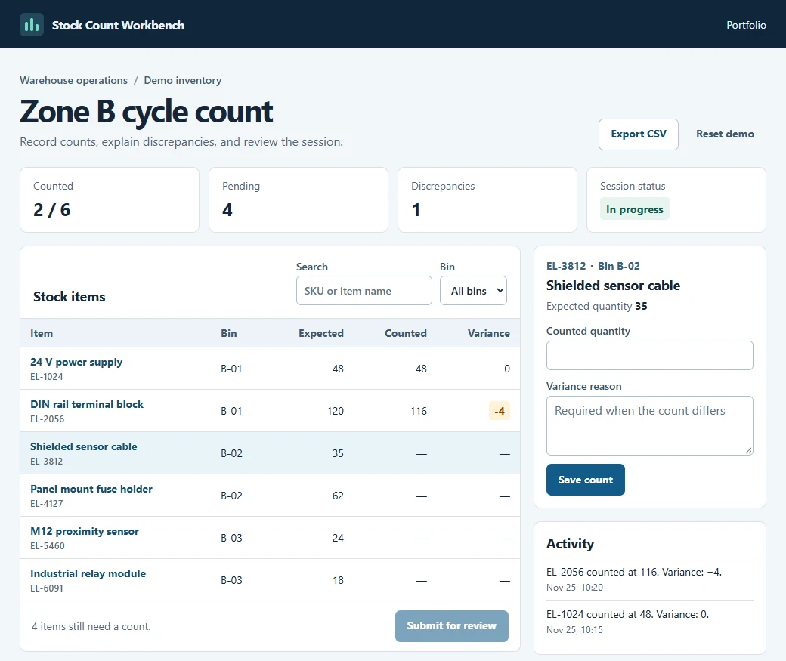

# Anupam Rawat’s developer portfolio

A personal Angular portfolio project by Anupam Rawat. The application pairs an engineering portfolio with a working warehouse cycle-count demo built with synthetic inventory data.



## Run locally

Use Node.js 24.15+ in the 24.x series and npm.

```sh
npm ci
npm start
```

Open `http://127.0.0.1:4200/` for the portfolio and `/#/workbench` for the demo.

## Demo walkthrough

1. Search by SKU or filter by bin. The seeded session starts with two items counted and one discrepancy.
2. Select **Shielded sensor cable**. Enter **31** against the expected **35** and try to save. The form requires a variance reason. Enter a reason and save again.
3. Count the remaining items and submit the session. Return it for recount or approve it. Approval locks editing and is recorded in Activity.
4. Export a CSV and reload the page to see browser-local persistence. Use **Reset demo** to restore the sample.

## Architecture

- Angular standalone routes keep the portfolio and workbench in separate lazy-loaded components.
- Typed reactive forms manage count entry. The inventory store independently enforces count bounds, required variance reasons and legal status transitions.
- Signals derive pending counts, discrepancies and filtered rows from a single session state. Local storage stores the sample session and its timestamped activity.
- A Playwright suite exercises validation, filtering, submit/review/approval, CSV export, persistence and narrow-screen navigation.

The demo uses one browser profile and a single simulated warehouse session. In a production design, a backend would own inventory data, access control, concurrent updates and the audit trail.

## Update the portfolio

Edit [portfolio content](src/portfolio-content.ts) to update the profile, capabilities, and employment timeline. Add public GitHub or résumé URLs to the optional profile fields when available.

Add one object to the `projects` array to publish a case study. For example:

```ts
{
  slug: 'release-checklist',
  title: 'Release Checklist',
  summary: 'A workspace for tracking release readiness.',
  role: 'Personal project · Frontend development',
  period: '2026',
  domain: 'Developer tools',
  stack: ['Angular', 'TypeScript'],
  kind: 'Personal project',
  problem: 'Release tasks were scattered across several checklists.',
  contribution: 'I built a shared view of the release tasks and their status.',
  decisions: [
    { title: 'Separate tasks from releases', description: 'Reusable task templates can seed each release.' },
  ],
  evidence: 'A public case study can include annotated screenshots or a demo.',
}
```

Use a unique lowercase slug with hyphens. The record appears in `/#/work` and at `/#/work/release-checklist` automatically. Set `featured: true` to show it on the home page in array order. For an image, put it in `public/` and set `visual` to `{ kind: 'image', src: 'release-checklist.webp', alt: '…', width: 1200, height: 800 }` using its actual dimensions. Use a relative asset path so GitHub Pages can serve it from a repository subdirectory. An optional `demo` takes an internal Angular route and button label. An optional `source` takes a public repository URL. To reference the project in the employment timeline, add its slug to `experience`.

Update the `capabilities` records to change the How I engineer panels. Each record connects a technical decision to a case-study slug. The portfolio uses native scrolling.

For new sections such as technical notes, add a lazy child route under the portfolio shell in [main.ts](src/main.ts) and a router link in the header in [portfolio.ts](src/portfolio.ts). Keep notes in their own typed content module and use the shell’s typography and layout classes.

## Test and build

```sh
npx playwright install chromium
npm test
npm run build -- --base-href ./
```

When testing on a machine with Chrome already installed, set `PLAYWRIGHT_CHROMIUM_EXECUTABLE_PATH` to its absolute executable path to reuse it.

## Publish with GitHub Pages

1. Create a GitHub repository named `stock-count-workbench` and push this directory to its `main` branch.
2. Set **Settings → Pages → Source** to **GitHub Actions**.
3. Run **Test and deploy portfolio** if a push has not already triggered it. The workflow tests and builds the app, then publishes the static site. Open the URL shown by the deployment.
4. Pin the repository on your profile and add the deployment URL to the repository description. The [profile README draft](docs/github-profile.md) is ready to adapt to your account.
